# Fish a Human: area building kit

98 low-poly building and prop models for the nine areas of the shared map, built in Blender.
They add to the existing ZoneKit props (palms, umbrellas, Ferris wheel and the rest) without duplicating any of them.

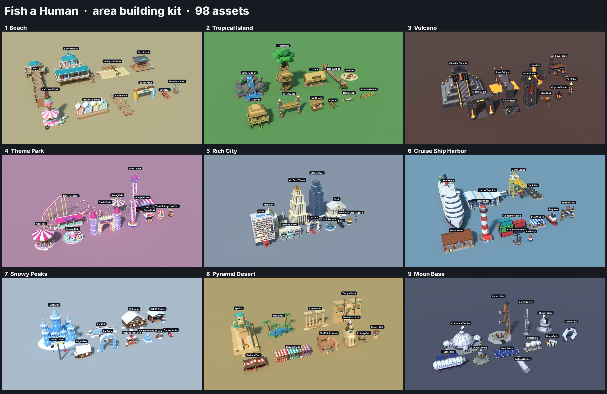

## What's here

| Path | What it is |
|---|---|
| `fbx/<Area>.fbx` | Every asset of an area in one file. Import this one. |
| `fbx/<Area>/<Asset>.fbx` | The same assets, one file each |
| `blend/<Area>.blend` | Editable Blender scenes (saved from Blender 5.2) |
| `roblox/AreaKitSetup.lua` | ModuleScript: paints, scales, pivots and files imported models |
| `roblox/AreaKitStyles.lua` | ModuleScript: colour and material for every part style |
| `previews/` | `<Area>.jpg` close-ups, `<Area>_lineup.jpg` everything together |
| `source/` | The Python that builds everything. Edit it and re-run to change a model |
| `assets.json` | Size, triangles and parts for each asset |

## Getting them into Roblox Studio

1. Put `AreaKitStyles.lua` and `AreaKitSetup.lua` in **ServerStorage** as two ModuleScripts. Name them `AreaKitStyles` and `AreaKitSetup`.
2. **Home → Import 3D** and pick `fbx/Beach.fbx` (or any area). Import it into Workspace.
3. In the command bar run:
   ```lua
   require(game.ServerStorage.AreaKitSetup).Run(workspace.Beach)
   ```
   Each asset becomes a Model in `ReplicatedStorage.AreaKit.<Area>`. The script also:
   - paints every part from AreaKitStyles
   - anchors the parts
   - sets the model to its real size in studs, so the importer's unit setting doesn't matter
   - puts the pivot at the bottom centre with the front facing −Z
   - adds a PointLight to each glowing part
4. Place copies with `model:Clone()` and `:PivotTo(CFrame)`, the same way WorldThemeController places ZoneKit props.

### Conventions
- 1 stud = 1 Blender unit, and the ground is y = 0. A person is about 6 studs tall, and doors are 7–9 studs.
- MeshParts are named `<Asset>_<Style>` (for example `BeachHouse_WoodLight`). The style name picks the colour and material.
- Each style is one MeshPart, so each asset is 4–23 parts. No part has more than about 9,000 triangles, well within Roblox's 20k limit.
- `Accent` and `Party` parts are meant to be recoloured per copy: `AreaKitSetup.Tint(model, Color3.fromRGB(...))`, or `Run(root, { Accent = ... })`.
  Examples: the beach-house siding, surf-shack awnings and the border pylons' glow strips.
- Glowing parts (lava, fire, windows, neon) use the Neon material.
- **Shared**: `BorderPylon` and `PricePlaque` are for the shadow walls between areas. `PricePlaque` has a black `PricePlaque_Black` face; put a SurfaceGui with the price on it.

## The assets

### 1 · Beach

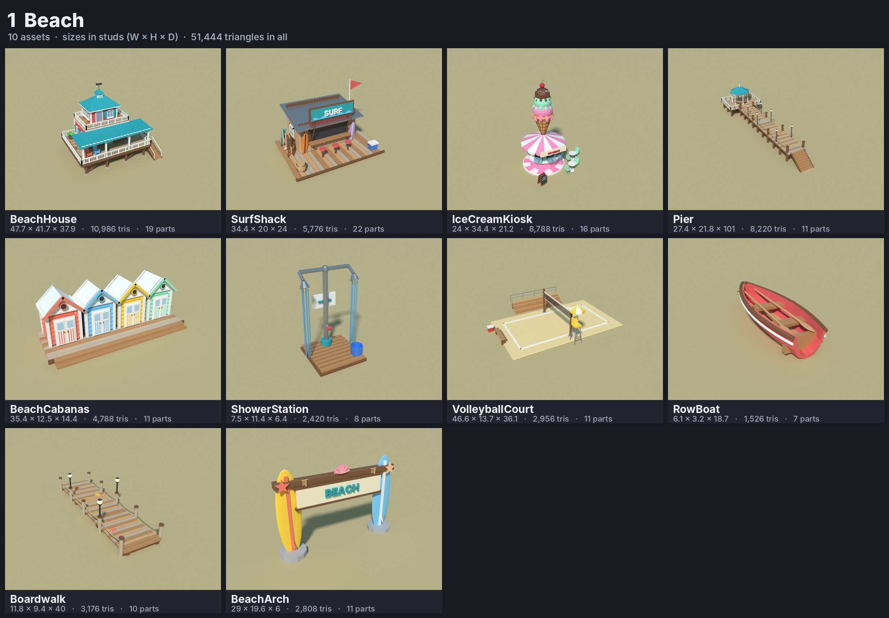

| Asset | W × H × D (studs) | Triangles | Parts |
|---|---|---:|---:|
| BeachHouse | 47.7 × 41.7 × 37.9 | 10,986 | 19 |
| SurfShack | 34.4 × 20 × 24 | 5,776 | 22 |
| IceCreamKiosk | 24 × 34.4 × 21.2 | 8,788 | 16 |
| Pier | 27.4 × 21.8 × 101 | 8,220 | 11 |
| BeachCabanas | 35.4 × 12.5 × 14.4 | 4,788 | 11 |
| ShowerStation | 7.5 × 11.4 × 6.4 | 2,420 | 8 |
| VolleyballCourt | 46.6 × 13.7 × 36.1 | 2,956 | 11 |
| RowBoat | 6.1 × 3.2 × 18.7 | 1,526 | 7 |
| Boardwalk | 11.8 × 9.4 × 40 | 3,176 | 10 |
| BeachArch | 29 × 19.6 × 6 | 2,808 | 11 |

### 2 · Tropical Island

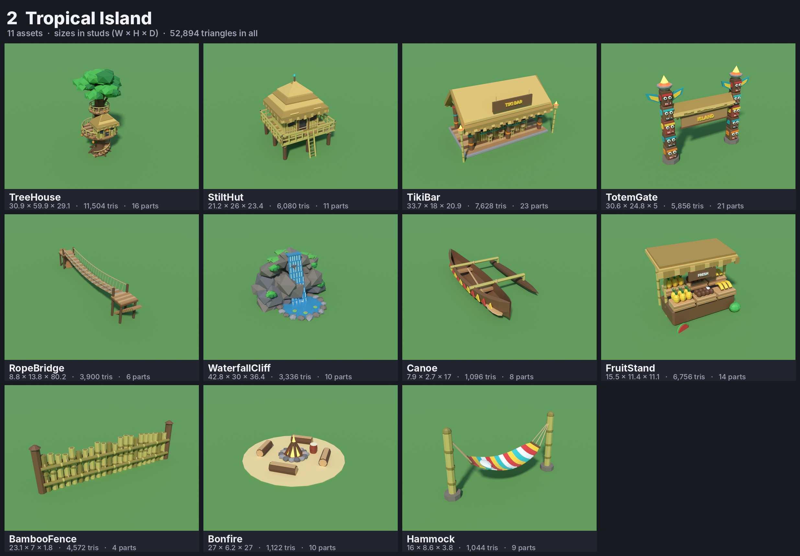

| Asset | W × H × D (studs) | Triangles | Parts |
|---|---|---:|---:|
| TreeHouse | 30.9 × 59.9 × 29.1 | 11,504 | 16 |
| StiltHut | 21.2 × 26 × 23.4 | 6,080 | 11 |
| TikiBar | 33.7 × 18 × 20.9 | 7,628 | 23 |
| TotemGate | 30.6 × 24.8 × 5 | 5,856 | 21 |
| RopeBridge | 8.8 × 13.8 × 80.2 | 3,900 | 6 |
| WaterfallCliff | 42.8 × 30 × 36.4 | 3,336 | 10 |
| Canoe | 7.9 × 2.7 × 17 | 1,096 | 8 |
| FruitStand | 15.5 × 11.4 × 11.1 | 6,756 | 14 |
| BambooFence | 23.1 × 7 × 1.8 | 4,572 | 4 |
| Bonfire | 27 × 6.2 × 27 | 1,122 | 10 |
| Hammock | 16 × 8.6 × 3.8 | 1,044 | 9 |

### 3 · Volcano

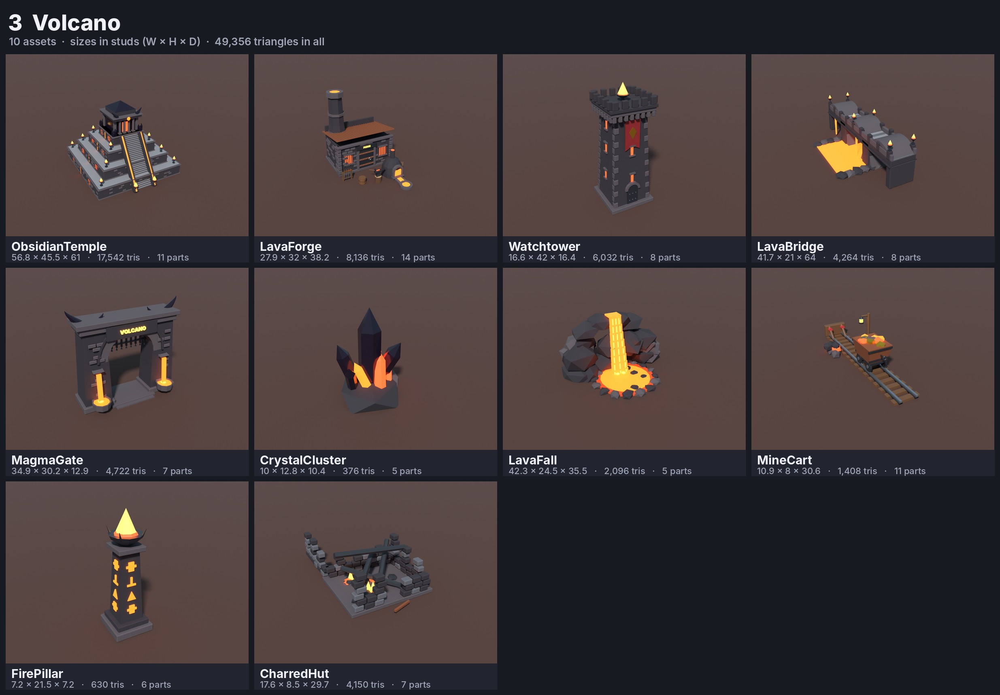

| Asset | W × H × D (studs) | Triangles | Parts |
|---|---|---:|---:|
| ObsidianTemple | 56.8 × 45.5 × 61 | 17,542 | 11 |
| LavaForge | 27.9 × 32 × 38.2 | 8,136 | 14 |
| Watchtower | 16.6 × 42 × 16.4 | 6,032 | 8 |
| LavaBridge | 41.7 × 21 × 64 | 4,264 | 8 |
| MagmaGate | 34.9 × 30.2 × 12.9 | 4,722 | 7 |
| CrystalCluster | 10 × 12.8 × 10.4 | 376 | 5 |
| LavaFall | 42.3 × 24.5 × 35.5 | 2,096 | 5 |
| MineCart | 10.9 × 8 × 30.6 | 1,408 | 11 |
| FirePillar | 7.2 × 21.5 × 7.2 | 630 | 6 |
| CharredHut | 17.6 × 8.5 × 29.7 | 4,150 | 7 |

### 4 · Theme Park

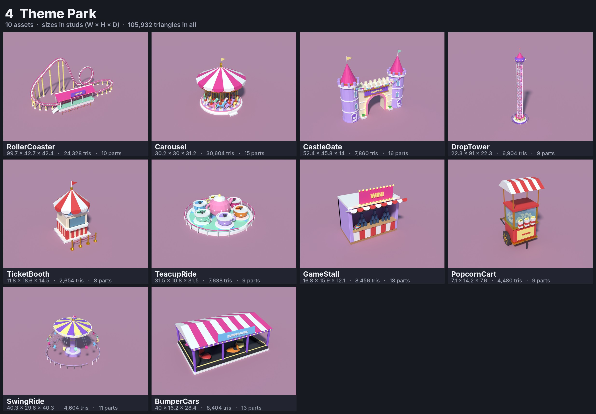

| Asset | W × H × D (studs) | Triangles | Parts |
|---|---|---:|---:|
| RollerCoaster | 99.7 × 42.7 × 42.4 | 24,328 | 10 |
| Carousel | 30.2 × 30 × 31.2 | 30,604 | 15 |
| CastleGate | 52.4 × 45.8 × 14 | 7,860 | 16 |
| DropTower | 22.3 × 91 × 22.3 | 6,904 | 9 |
| TicketBooth | 11.8 × 18.6 × 14.5 | 2,654 | 8 |
| TeacupRide | 31.5 × 10.8 × 31.5 | 7,638 | 9 |
| GameStall | 16.8 × 15.9 × 12.1 | 8,456 | 18 |
| PopcornCart | 7.1 × 14.2 × 7.6 | 4,480 | 9 |
| SwingRide | 40.3 × 29.6 × 40.3 | 4,604 | 11 |
| BumperCars | 40 × 16.2 × 28.4 | 8,404 | 13 |

### 5 · Rich City

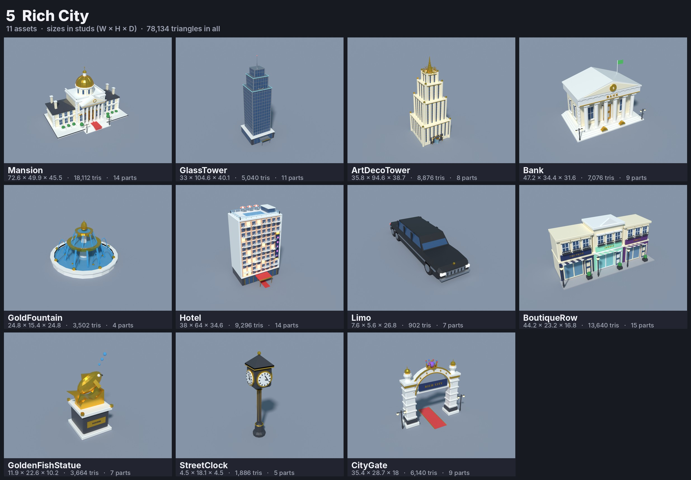

| Asset | W × H × D (studs) | Triangles | Parts |
|---|---|---:|---:|
| Mansion | 72.6 × 49.9 × 45.5 | 18,112 | 14 |
| GlassTower | 33 × 104.6 × 40.1 | 5,040 | 11 |
| ArtDecoTower | 35.8 × 94.6 × 38.7 | 8,876 | 8 |
| Bank | 47.2 × 34.4 × 31.6 | 7,076 | 9 |
| GoldFountain | 24.8 × 15.4 × 24.8 | 3,502 | 4 |
| Hotel | 38 × 64 × 34.6 | 9,296 | 14 |
| Limo | 7.6 × 5.6 × 26.8 | 902 | 7 |
| BoutiqueRow | 44.2 × 23.2 × 16.8 | 13,640 | 15 |
| GoldenFishStatue | 11.9 × 22.6 × 10.2 | 3,664 | 7 |
| StreetClock | 4.5 × 18.1 × 4.5 | 1,886 | 5 |
| CityGate | 35.4 × 28.7 × 18 | 6,140 | 9 |

### 6 · Cruise Ship Harbor

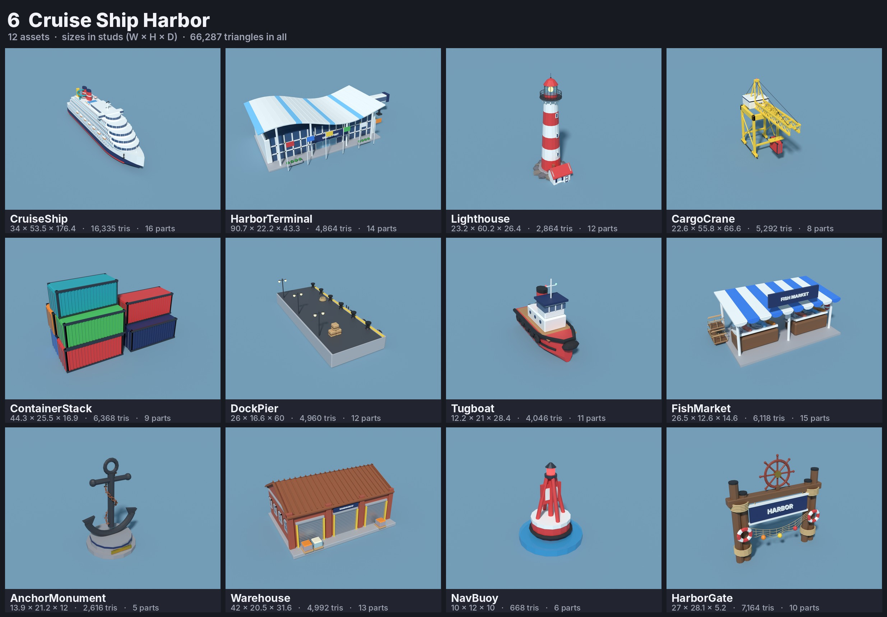

| Asset | W × H × D (studs) | Triangles | Parts |
|---|---|---:|---:|
| CruiseShip | 34 × 53.5 × 176.4 | 16,335 | 16 |
| HarborTerminal | 90.7 × 22.2 × 43.3 | 4,864 | 14 |
| Lighthouse | 23.2 × 60.2 × 26.4 | 2,864 | 12 |
| CargoCrane | 22.6 × 55.8 × 66.6 | 5,292 | 8 |
| ContainerStack | 44.3 × 25.5 × 16.9 | 6,368 | 9 |
| DockPier | 26 × 16.6 × 60 | 4,960 | 12 |
| Tugboat | 12.2 × 21 × 28.4 | 4,046 | 11 |
| FishMarket | 26.5 × 12.6 × 14.6 | 6,118 | 15 |
| AnchorMonument | 13.9 × 21.2 × 12 | 2,616 | 5 |
| Warehouse | 42 × 20.5 × 31.6 | 4,992 | 13 |
| NavBuoy | 10 × 12 × 10 | 668 | 6 |
| HarborGate | 27 × 28.1 × 5.2 | 7,164 | 10 |

### 7 · Snowy Peaks

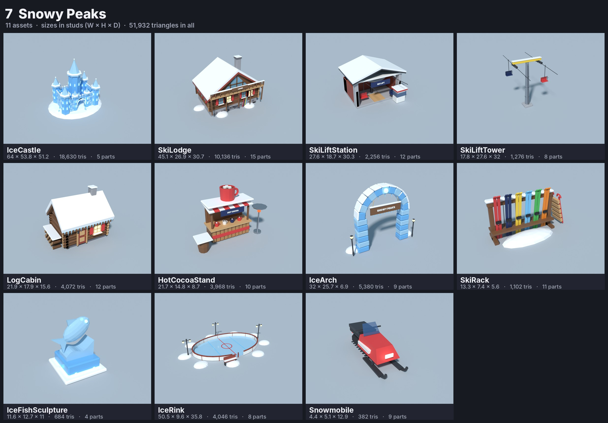

| Asset | W × H × D (studs) | Triangles | Parts |
|---|---|---:|---:|
| IceCastle | 64 × 53.8 × 51.2 | 18,630 | 5 |
| SkiLodge | 45.1 × 26.9 × 30.7 | 10,136 | 15 |
| SkiLiftStation | 27.6 × 18.7 × 30.3 | 2,256 | 12 |
| SkiLiftTower | 17.8 × 27.6 × 32 | 1,276 | 8 |
| LogCabin | 21.9 × 17.9 × 15.6 | 4,072 | 12 |
| HotCocoaStand | 21.7 × 14.8 × 8.7 | 3,968 | 10 |
| IceArch | 32 × 25.7 × 6.9 | 5,380 | 9 |
| SkiRack | 13.3 × 7.4 × 5.6 | 1,102 | 11 |
| IceFishSculpture | 11.6 × 12.7 × 11 | 684 | 4 |
| IceRink | 50.5 × 9.6 × 35.8 | 4,046 | 8 |
| Snowmobile | 4.4 × 5.1 × 12.9 | 382 | 9 |

### 8 · Pyramid Desert

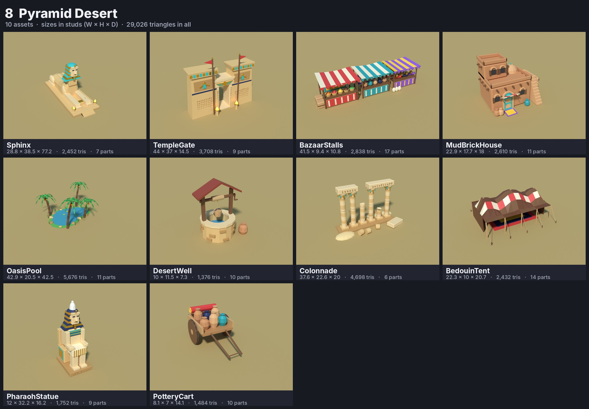

| Asset | W × H × D (studs) | Triangles | Parts |
|---|---|---:|---:|
| Sphinx | 28.8 × 38.5 × 77.2 | 2,452 | 7 |
| TempleGate | 44 × 37 × 14.5 | 3,708 | 9 |
| BazaarStalls | 41.5 × 9.4 × 10.8 | 2,838 | 17 |
| MudBrickHouse | 22.9 × 17.7 × 18 | 2,610 | 11 |
| OasisPool | 42.9 × 20.5 × 42.5 | 5,676 | 11 |
| DesertWell | 10 × 11.5 × 7.3 | 1,376 | 10 |
| Colonnade | 37.6 × 22.6 × 20 | 4,698 | 6 |
| BedouinTent | 22.3 × 10 × 20.7 | 2,432 | 14 |
| PharaohStatue | 12 × 32.2 × 16.2 | 1,752 | 9 |
| PotteryCart | 8.1 × 7 × 14.1 | 1,484 | 10 |

### 9 · Moon Base

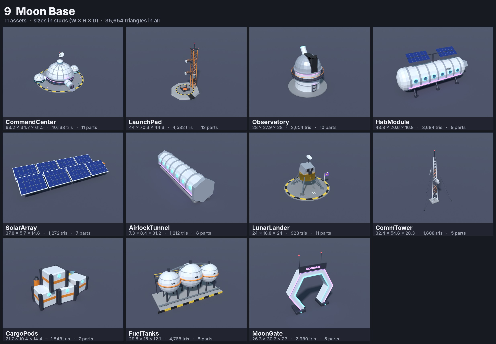

| Asset | W × H × D (studs) | Triangles | Parts |
|---|---|---:|---:|
| CommandCenter | 63.2 × 34.7 × 61.5 | 10,168 | 11 |
| LaunchPad | 44 × 70.6 × 44.6 | 4,532 | 12 |
| Observatory | 28 × 27.9 × 28 | 2,654 | 10 |
| HabModule | 43.8 × 20.6 × 16.8 | 3,684 | 9 |
| SolarArray | 37.8 × 5.7 × 14.6 | 1,272 | 7 |
| AirlockTunnel | 7.3 × 8.4 × 31.2 | 1,212 | 6 |
| LunarLander | 24 × 16.8 × 24 | 928 | 11 |
| CommTower | 32.4 × 54.6 × 28.3 | 1,608 | 5 |
| CargoPods | 21.7 × 10.4 × 14.4 | 1,848 | 7 |
| FuelTanks | 29.5 × 15 × 12.1 | 4,768 | 8 |
| MoonGate | 26.3 × 30.7 × 7.7 | 2,980 | 5 |

### Shared border pieces

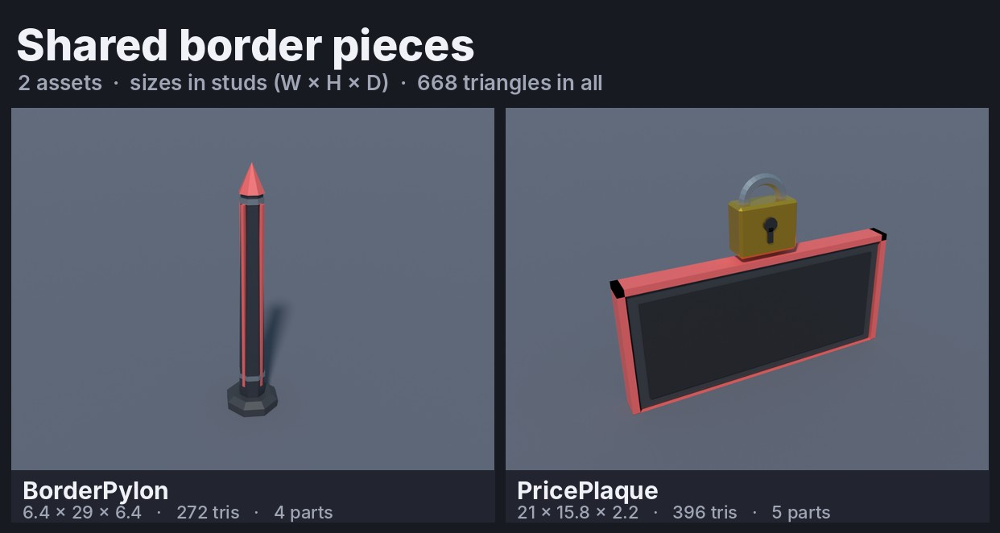

| Asset | W × H × D (studs) | Triangles | Parts |
|---|---|---:|---:|
| BorderPylon | 6.4 × 29 × 6.4 | 272 | 4 |
| PricePlaque | 21 × 15.8 × 2.2 | 396 | 5 |

## Changing or rebuilding a model

Everything is generated from `source/`: `kit.py` (shapes and styles) and `area_*.py` (one file per area, one function per asset).

```bash
python3 -m venv bvenv && ./bvenv/bin/pip install bpy==5.2.2 pillow
./bvenv/bin/python source/run.py area_beach draft solo only=SurfShack   # quick look at one asset
./bvenv/bin/python source/export.py .                                   # rebuild every FBX, .blend and render
python3 source/sheet.py . && python3 source/roblox_lua.py . && python3 source/readme.py .
```
