# Fish a Human: sea creature character rigs

Eleven playable sea creature characters on the default blocky R15 rig, built in Blender.
Each one is 5.2 studs tall like the default character and keeps the regular Roblox head, so the player's face shows.
The fish, sharks, eel, orca, octopus and squid wear their creature's head as a hood: the player's face looks out through its mouth.
The crab keeps the bare head with eye stalks on it, and the jellyfish wears its glowing bell as a cap.
Each body is shaped like its animal (round pufferfish, V-shaped shark, soft octopus, armoured crab) while staying a normal R15 humanoid.
The style is cartoon: big round mitts and feet in an accent colour, big shiny eyes with eyebrows that give each creature a mood
(angry shark and squid, grumpy eel, surprised pufferfish, happy tiny fish and octopus), blush on the cute ones, and bright colours
with a glossy, toy-like shading baked into the textures.

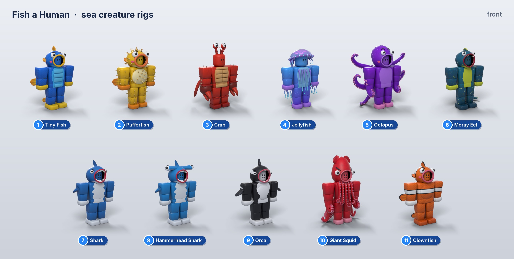

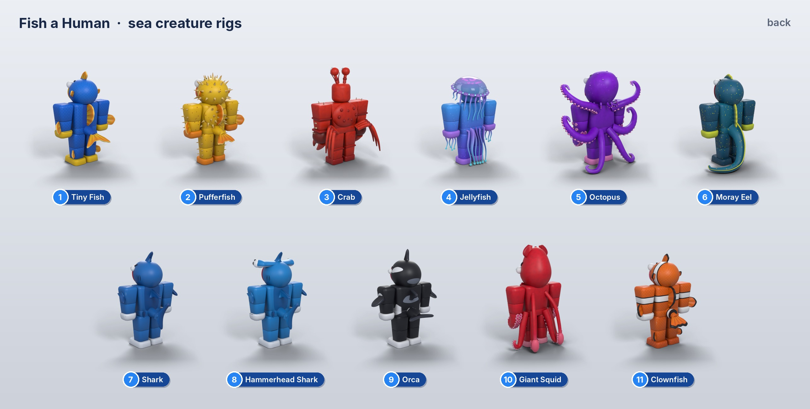

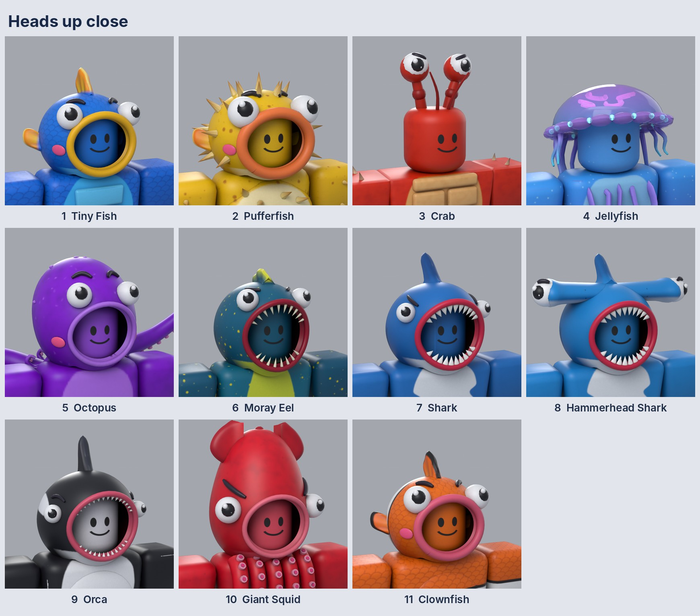

## What's here

| Path | What it is |
|---|---|
| `fbx/<Creature>.fbx` | The rig to import: 15 R15 body parts, the creature pieces and joint markers. The texture is embedded. |
| `textures/<Creature>.png` | The creature's 1024×1024 texture; every part of a creature shares it |
| `roblox/SeaCreatureRigSetup.lua` | ModuleScript: turns an imported FBX into a working R15 character, and morphs players |
| `blend/<Creature>.blend` | Editable Blender scenes (saved from Blender 5.2) |
| `previews/` | `Lineup_Front.jpg`, `Lineup_Back.jpg`, `Heads.jpg` (close-ups) and one `<Creature>.jpg` each |
| `source/` | The Python that builds everything. Edit it and re-run to change a creature |
| `rigs.json` | Parts, triangles and size of each rig |

## Getting a rig into Roblox Studio

1. Put `SeaCreatureRigSetup.lua` in **ServerStorage** as a ModuleScript named `SeaCreatureRigSetup`.
2. **Home → Import 3D** and pick `fbx/Shark.fbx` (or any creature). Import it into Workspace.
3. In the command bar run:
   ```lua
   require(game.ServerStorage.SeaCreatureRigSetup).Run(workspace.Shark)
   ```
   The finished character goes to `ReplicatedStorage.SeaCreatureRigs.Shark`. The script:
   - scales it to 5.2 studs, so the importer's unit setting doesn't matter
   - adds the HumanoidRootPart, a Humanoid (R15) and the standard R15 joints (Root, Waist, Neck, LeftShoulder …), so the default animations play
   - adds the usual accessory attachments (hat, hair, face, shoulders, waist), so hats and tools still fit
   - welds every creature piece to its body part (no collision, massless). Glowing pieces become Neon and the jelly bell becomes glass
   - puts the classic face on the head (`Run(model, { Face = "rbxassetid://…" })` for another)
4. If a rig imports without its texture, upload `textures/<Creature>.png` and pass it in: `Run(workspace.Shark, { TextureId = "rbxassetid://…" })`.

## Turning a player into a creature

From a server script:
```lua
local Rigs = require(game.ServerStorage.SeaCreatureRigSetup)
Rigs.Morph(player, "Shark")   -- keeps the player's face, position and default animations
```
To make a creature the default character instead, copy its rig into **StarterPlayer** and name it `StarterCharacter`.

## Conventions

- Body parts are named exactly as in R15 (`Head`, `UpperTorso`, `LeftUpperArm` …) and keep the blocky R15 sizes.
- Creature pieces are named `<BodyPart>__<Piece>`, for example `Head__Fin` or `LowerTorso__Tail`. The setup script welds each one to the body part before the `__`.
- `Head__Hood` is the creature hood. It is welded to the head and has an opening for the face.
- Pieces stay clear of the face on the front of the head.
- `Joint_<Name>` cubes mark the R15 joints; the setup script turns them into rig attachments and deletes them.
- Every part is under Roblox's 20,000-triangle limit.
- Nothing floats: `source/check_attach.py` checks that every piece touches the body part it is welded to (the hood and the jelly bell count as part of the head).

## The rigs

| # | Creature | Parts | Triangles | Largest part (tris) | Size W × H × D (studs) |
|---:|---|---:|---:|---:|---|
| 1 | Tiny Fish | 24 | 42,996 | 11,880 | 4.78 × 5.97 × 2.54 |
| 2 | Pufferfish | 31 | 39,928 | 11,880 | 4.78 × 5.89 × 2.57 |
| 3 | Crab | 17 | 19,070 | 4,096 | 4.25 × 6.22 × 2.73 |
| 4 | Jellyfish | 22 | 18,858 | 3,982 | 4.02 × 5.65 × 2.39 |
| 5 | Octopus | 19 | 50,668 | 14,416 | 6.13 × 6.03 × 2.69 |
| 6 | Moray Eel | 19 | 32,076 | 12,512 | 4.21 × 5.78 × 2.93 |
| 7 | Shark | 22 | 36,764 | 12,692 | 4.44 × 6.1 × 3.12 |
| 8 | Hammerhead Shark | 23 | 39,320 | 10,304 | 4.44 × 6.09 × 3.04 |
| 9 | Orca | 21 | 33,472 | 13,052 | 5.14 × 6.26 × 2.69 |
| 10 | Giant Squid | 19 | 53,292 | 13,252 | 4.13 × 6.52 × 2.67 |
| 11 | Clownfish | 24 | 43,640 | 11,880 | 4.78 × 5.97 × 2.54 |

Height is the whole model including fins, bells and mantles. The body itself is 5.2 studs tall on every rig.

### 1 · Tiny Fish

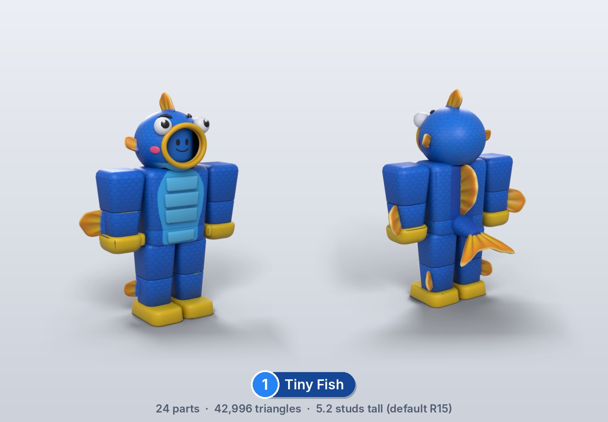

### 2 · Pufferfish

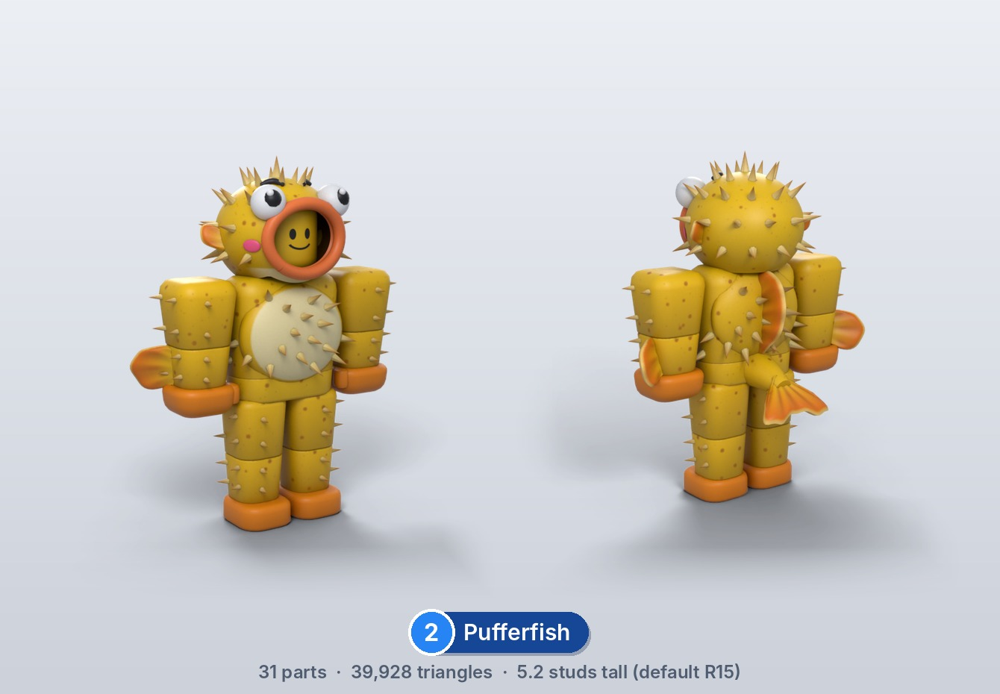

### 3 · Crab

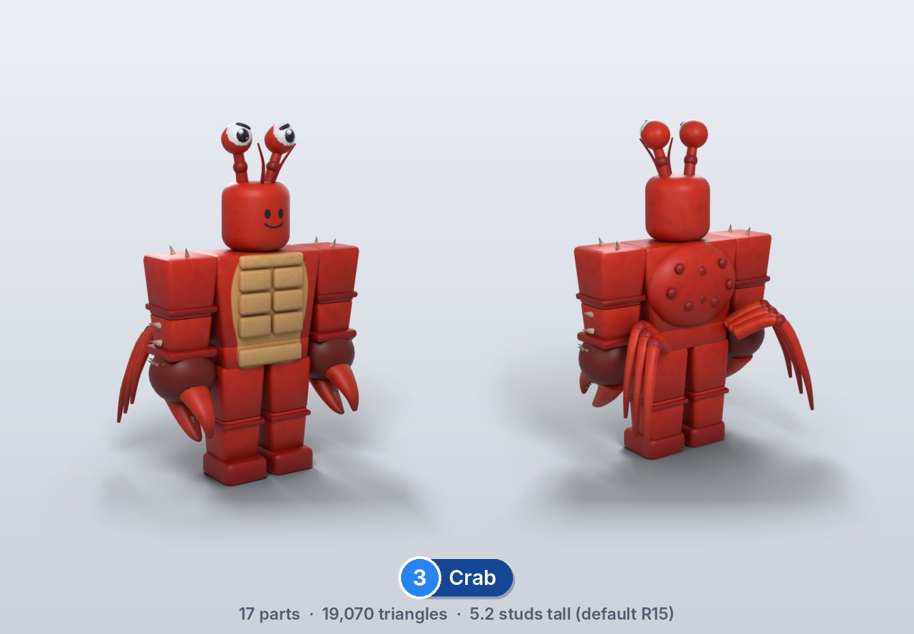

### 4 · Jellyfish

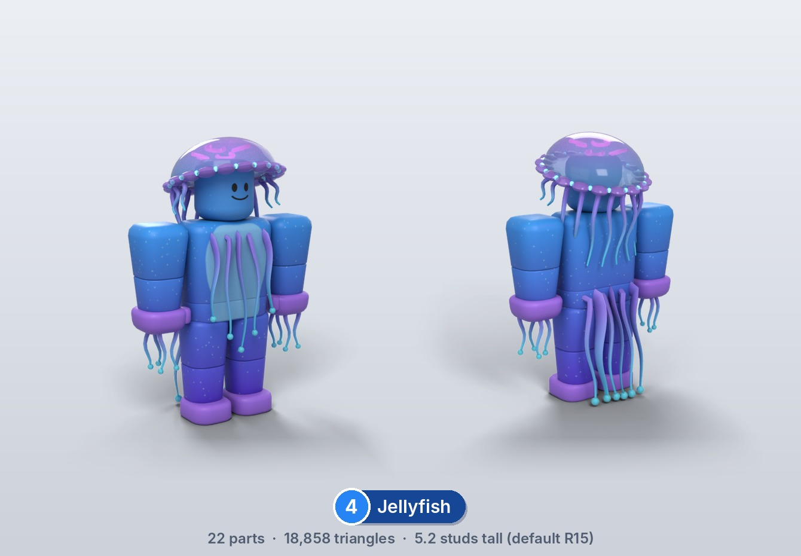

### 5 · Octopus

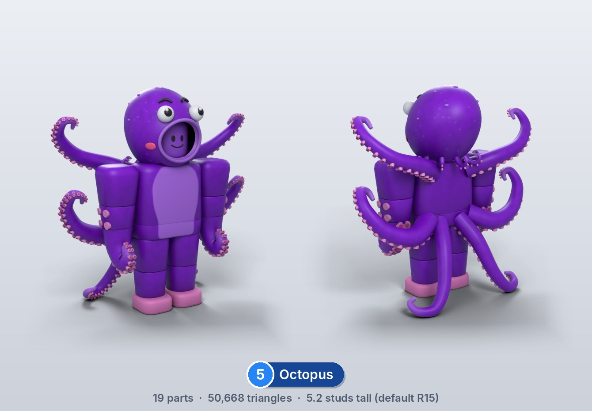

### 6 · Moray Eel

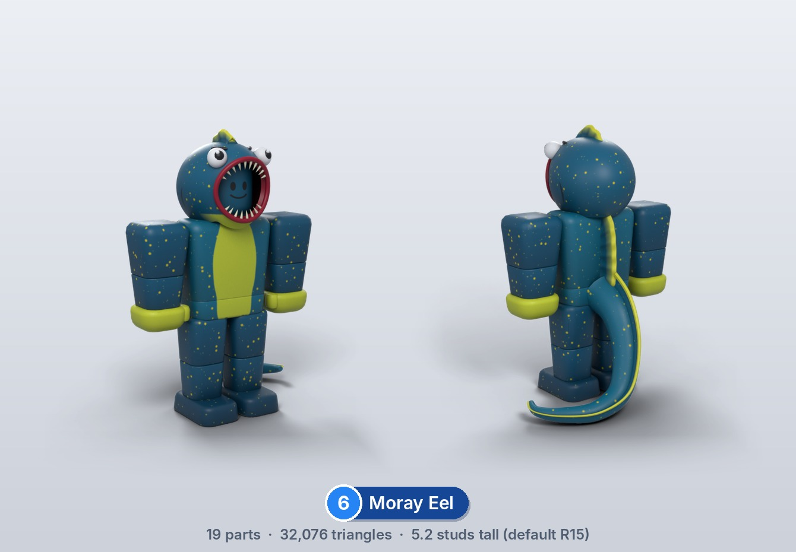

### 7 · Shark

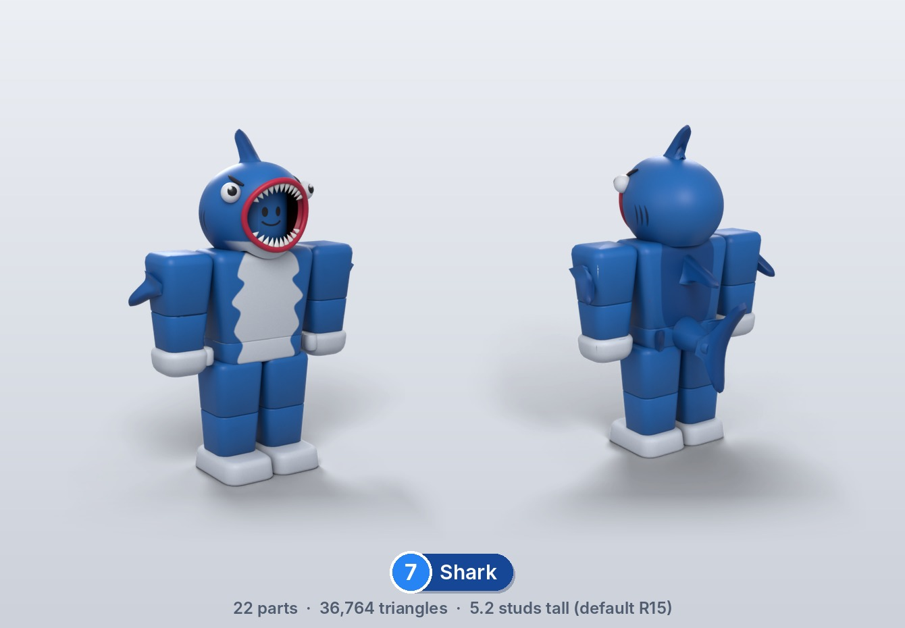

### 8 · Hammerhead Shark

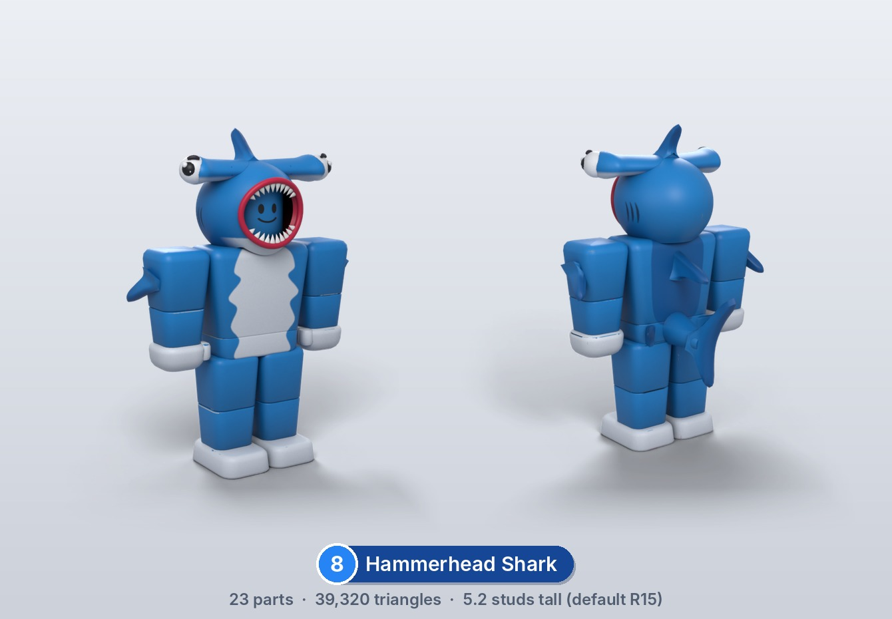

### 9 · Orca

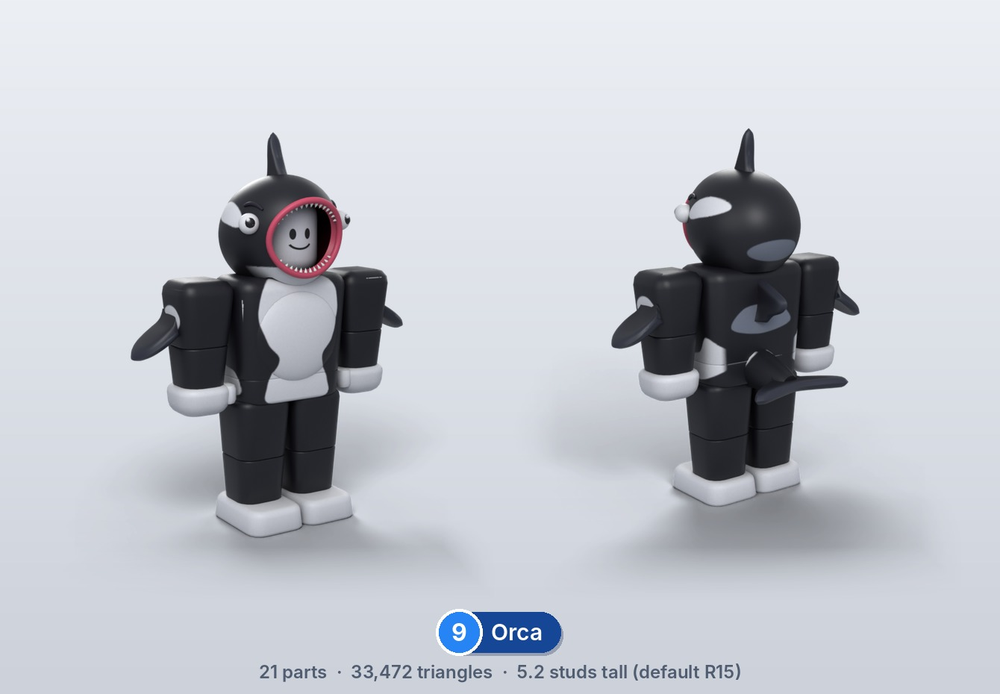

### 10 · Giant Squid

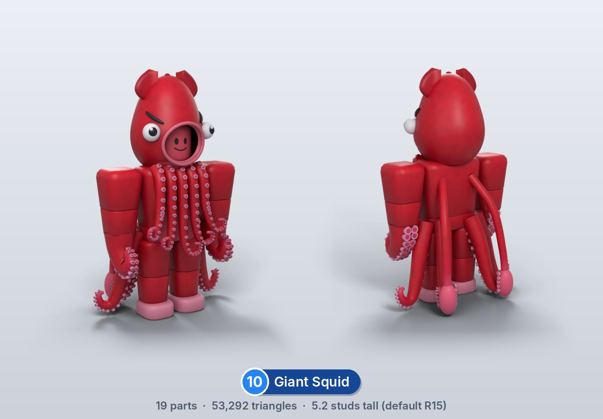

### 11 · Clownfish

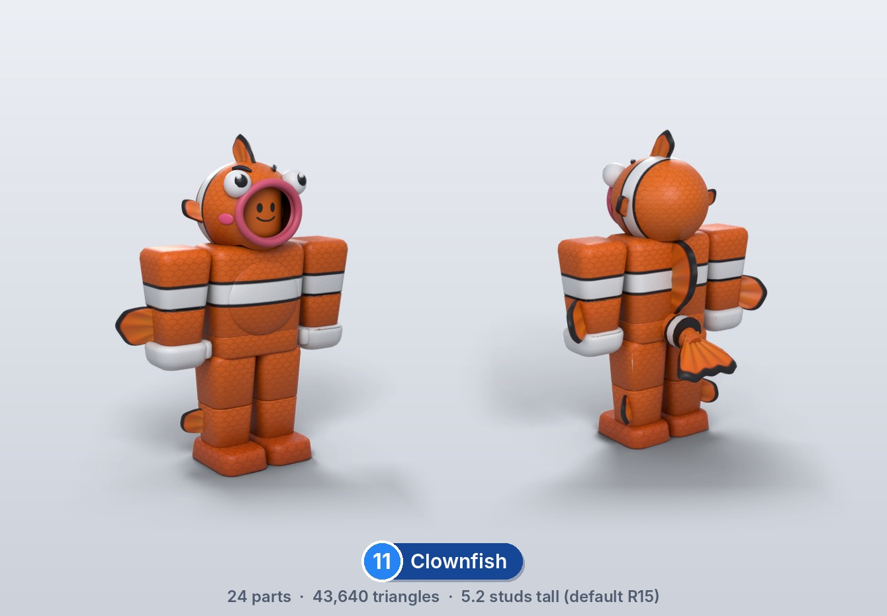

## Changing or rebuilding a rig

`source/char.py` holds the R15 body, fins, materials and texture bake; `source/creatures.py` has one function per creature.
`kit.py` is the shared shape library from the area kit.

```bash
python3 -m venv bvenv && ./bvenv/bin/pip install bpy==5.2.2 pillow numpy
./bvenv/bin/python source/build.py . draft only=Shark --no-export   # quick look at one creature
./bvenv/bin/python source/build.py . final                         # rebuild every FBX, texture, .blend and render
./bvenv/bin/python source/lineup.py . && python3 source/readme_rigs.py .
./bvenv/bin/python source/check_attach.py                         # every piece must touch its body part
```
